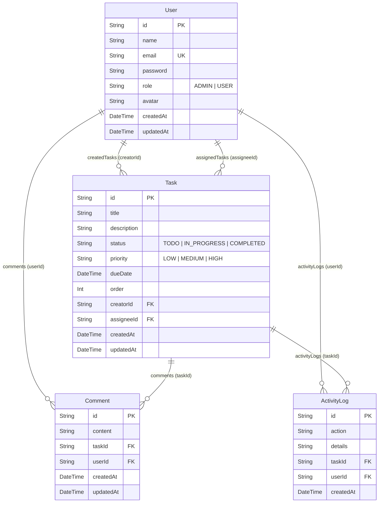

# Swan Task Management System
> Production-grade Full Stack Task Management System built for **Swan Digital Solutions** Technical Assessment.

[](https://nextjs.org/)
[](https://react.dev/)
[](https://www.typescriptlang.org/)
[](https://tailwindcss.com/)
[](https://www.prisma.io/)
[](https://www.sqlite.org/)
[](./tests/run-tests.js)

---

## 📌 Project Overview

**Swan TaskFlow** is a modern, responsive, and robust full-stack task management platform designed to streamline team collaboration, sprint tracking, and project monitoring. The application features **Role-Based Access Control (Admin and Team Member)**, an interactive **Drag-and-Drop Kanban Board**, a dynamic **Real-Time Analytics Dashboard**, tabular **Task List with Multi-Filtering & Sorting**, timestamped **Task Comments and Audit Activity History**, and **One-Click CSV Export**.

---

## 🚀 Key Features

### 1. 🔐 Authentication & Role-Based Access Control (RBAC)
- **User Registration & Login**: Built with secure `bcryptjs` password hashing (salt rounds: 10) and signed `jose` JSON Web Tokens (JWT).
- **Session Security**: Delivered via secure `HTTP-only` cookies + fallback `Bearer` Authorization headers for REST clients (Postman/curl).
- **Role Enforcement**:
  - **Administrators**: Can create, reassign, modify, and delete any task in the workspace.
  - **Team Members**: Can create tasks, manage statuses, and only delete tasks they personally authored.
- **Evaluator Quick-Switch**: One-click quick login for reviewers to switch roles seamlessly.

### 2. 📋 Kanban Board with Drag-and-Drop
- Interactive columns for **To Do**, **In Progress**, and **Completed**.
- **Native Drag-and-Drop**: Smooth drag interaction with drag handles, column hover indicators, and **optimistic UI updates** with automatic rollback on failure.
- Status, priority indicators, assignee avatars, comment badges, and due date countdowns.

### 3. 📊 Real-Time Analytics Dashboard
- **KPI Summary Cards**: Total Tasks, Pending Tasks, Completed Tasks (with completion % rate), and Overdue Tasks.
- **Attention Alert Banner**: Highlights overdue items with days elapsed.
- **Data Visualizations**:
  - **Status Distribution Chart**: Multi-segment progress visual showing workload division.
  - **Priority Breakdown**: Comparative bar charts for High, Medium, and Low priorities.
- **Upcoming Deadlines Panel**: Sorted chronological list of upcoming deliverables.
- **Recent Team Activity Feed**: Timestamped audit trail of all project changes.

### 4. 🔍 Search, Multi-Filter & Sorting
- **Real-Time Search**: Instant search by task title and description.
- **Multi-Filter Dropdowns**: Filter by Status (`To Do`, `In Progress`, `Completed`), Priority (`Low`, `Medium`, `High`), and Assignees.
- **Sorting Options**: Sort by Due Date (Earliest / Latest), Priority (High to Low / Low to High), Created Date, and Title (A-Z).
- **Responsive Table & Mobile Cards**: Adaptive layouts optimized for both desktop viewports and mobile screens.

### 5. 💬 Task Detail Drawer, Comments & Audit Log
- Slide-over detail drawer displaying full task metadata.
- **Task Comments Thread**: Post updates and feedback with timestamps and author profiles.
- **Audit Activity Trail**: Logs automated event history (creation, status changes, priority changes, reassignments).

### 6. 📄 Reporting & Bonus Utilities
- **One-Click CSV Export**: Download filtered task data directly as a `.csv` file with complete metadata.
- **Interactive API Documentation**: In-app visual API explorer detailing request bodies, parameters, and sample responses.
- **Demo Reset / Re-seed**: One-click seed button to restore sample test data at any time.

---

## 🛠️ Technology Stack & Justification

| Layer | Technology | Justification |
|---|---|---|
| **Frontend Framework** | **Next.js 16 (App Router) + React 19** | Server/Client components, fast routing, and clean unified architecture. |
| **Language** | **TypeScript 5.9** | Strict static type safety across API routes, UI components, and Prisma schemas. |
| **Styling & UI** | **Tailwind CSS v4 + Lucide Icons** | Utility-first CSS, modern responsive design system, and accessible iconography. |
| **Backend & REST API** | **Next.js Route Handlers** | Standard RESTful API endpoints with structured JSON responses and HTTP status codes. |
| **Validation** | **Zod 4.6** | Schema-based runtime validation for registration, login, tasks, and comments. |
| **Database & ORM** | **Prisma 6.4 + SQLite / PostgreSQL** | Type-safe queries, migration system, relational foreign keys, zero-config local run. |
| **Security** | **bcryptjs + jose JWT** | Cryptographic password hashing and edge-compatible token signing. |
| **Containerization** | **Docker & Docker Compose** | Multi-stage production container build for consistent deployment. |

---

## 👥 Demo Login Credentials

For evaluation purposes, the database is pre-seeded with realistic team members and tasks:

| Role | Email | Password | Permissions |
|---|---|---|---|
| **Admin** | `admin@swan.com` | `password123` | Full administrative privileges (manage, reassign, delete any task) |
| **Member** | `sarah@swan.com` | `password123` | Standard team member (manage assigned tasks, delete authored tasks) |
| **Member** | `david@swan.com` | `password123` | Standard team member |
| **Member** | `priya@swan.com` | `password123` | Standard team member |

> **Evaluator Tip**: You can also use the one-click **"Evaluator Quick-Switch"** buttons right on the Login page or in the top navigation bar!

---

## ⚡ Quick Start & Local Setup

### Prerequisites
- **Node.js**: v18.0.0 or later (Tested on Node.js v24)
- **npm**: v9.0.0 or later

### Installation Steps

1. **Clone the repository:**
   ```bash
   git clone <repository-url>
   cd swan-task-management-system
   ```

2. **Install dependencies:**
   ```bash
   npm install
   ```

3. **Configure Environment Variables:**
   A template file `.env.example` is provided. Create your `.env` file:
   ```bash
   cp .env.example .env
   ```
   *(Local development works out-of-the-box with the default SQLite database path).*

4. **Initialize the Database & Seed Sample Data:**
   ```bash
   # Push schema to SQLite database
   npx prisma db push

   # Seed database with demo users, tasks, comments, and audit logs
   npm run seed
   ```

5. **Start the Development Server:**
   ```bash
   npm run dev
   ```
   Open **[http://localhost:3000](http://localhost:3000)** in your browser.

6. **Run Automated Test Suite:**
   ```bash
   npm test
   ```

---

## 🐳 Running with Docker

Run the entire application in a container with a single command:

```bash
docker compose up --build
```
The application will be live at `http://localhost:3000`.

---

## 🗄️ Database Schema & Relational Design

The system utilizes **Prisma ORM** with relational integrity and cascade rules:



---

## 🌐 REST API Reference

All responses follow the standardized format:
```json
{
  "success": true,
  "data": { ... },
  "message": "Operation successful"
}
```

| Method | Endpoint | Description | Auth Required | Access Level |
|---|---|---|---|---|
| `POST` | `/api/auth/register` | Register new user | No | Public |
| `POST` | `/api/auth/login` | Login user & issue JWT | No | Public |
| `POST` | `/api/auth/logout` | Clear auth cookie | No | Public |
| `GET` | `/api/auth/me` | Fetch active user profile | Yes | Any Authenticated |
| `GET` | `/api/users` | List team members for assignment | Yes | Any Authenticated |
| `GET` | `/api/tasks` | List tasks (search, filter, sort) | Yes | Any Authenticated |
| `POST` | `/api/tasks` | Create task & log audit event | Yes | Any Authenticated |
| `GET` | `/api/tasks/:id` | Get task with comments & activity | Yes | Any Authenticated |
| `PATCH` | `/api/tasks/:id` | Update task & record audit log | Yes | Any Authenticated |
| `DELETE`| `/api/tasks/:id` | Delete task | Yes | **Admin or Task Creator** |
| `POST` | `/api/tasks/:id/comments` | Post comment to task | Yes | Any Authenticated |
| `GET` | `/api/dashboard/stats` | KPI counters & chart aggregations | Yes | Any Authenticated |
| `GET` | `/api/tasks/export/csv` | Download tasks as CSV | Yes | Any Authenticated |
| `POST` | `/api/seed` | Reset & reseed demo workspace | No | Evaluator Tool |

---

## 🚀 Production Deployment Guide

### Deploying to Vercel (Recommended)
1. Push your repository to GitHub.
2. Sign in to [Vercel](https://vercel.com) and import the repository.
3. For persistent storage in production, connect a PostgreSQL database (e.g. **Neon**, **Supabase**, or **Vercel Postgres**):
   - Set `DATABASE_URL` in Vercel Environment Variables.
   - In `prisma/schema.prisma`, change `provider = "sqlite"` to `provider = "postgresql"`.
4. Add environment variables:
   - `JWT_SECRET`: A secure 32+ character random secret.
   - `NEXT_PUBLIC_APP_URL`: Your live production domain.
5. Click **Deploy**. Vercel will automatically run `prisma generate && next build`.

---

## 🧪 Testing

The repository includes an automated test runner checking:
- `bcryptjs` password hashing and rejection of incorrect passwords.
- `zod` input validation and rejection of invalid statuses and short titles.
- Database relational integrity (User -> Task -> Comments -> ActivityLog).
- Dynamic overdue deadline calculations.

To run:
```bash
npm test
```

---

## 👨‍💻 Candidate Submission Notes

- **Position**: Full Stack Developer Intern
- **Company**: Swan Digital Solutions
- **Submission**: GitHub Repository + Live Application Deployment + README
- Built with clean code practices, maintainable component hierarchy, strict type checking, and zero external UI component libraries.
